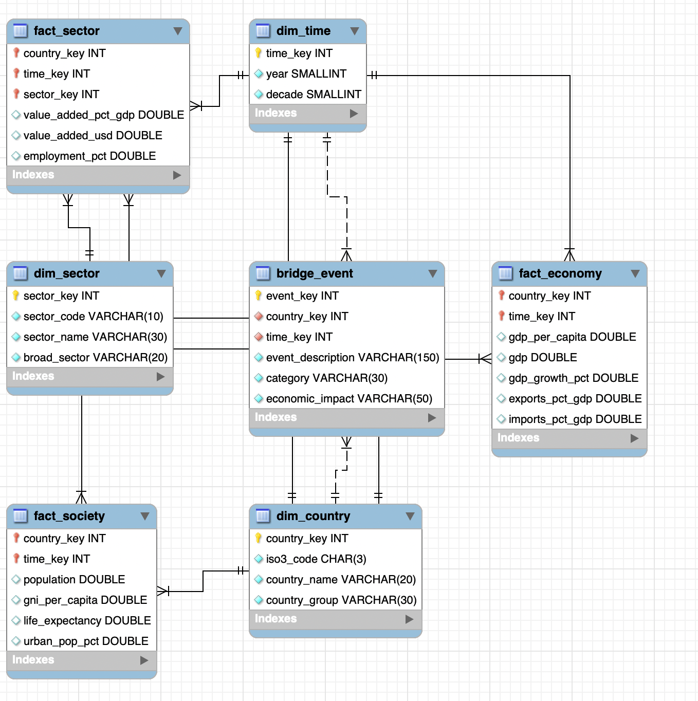

# Portugal's Economic and Human Development: A Century of Transformation

An end-to-end **data warehouse and OLAP project** that integrates three heterogeneous sources (Maddison Project, World Bank WDI and a historical events dataset) to analyse how Portugal developed from 1900 to 2025 compared with 14 other European countries and the EU.

Built for the course *Análise e Integração de Dados* (AID), Instituto Superior Técnico (IST), Universidade de Lisboa, 2026/2027.

📄 **Final report:** [`08_report/report_preview.pdf`](08_report/report_preview.pdf)

**Stack:** MySQL 8 · Apache Hop (ETL) · Mondrian (OLAP) · Saiku · MDX · Pentaho Report Designer

---

## Key findings

- **Portugal's GDP per capita grew about 14× since 1900**, but has stayed at about **70% of the Western European average since the 1970s**.
- **Two convergence periods:** 1960–1973 (fastest growth, ×3.4 between 1950 and 1973) and 1986–1991, right after joining the EEC. Portugal went from 54% of the Western average in the 1950s to 76% in the 1990s.
- **Divergence after 2000:** Portugal's GDP per capita fell from about 90% of Spain's in the 1990s to about 80% in the 2000s and 2010s.

  | Decade | 1960s | 1970s | 1980s | 1990s | 2000s | 2010s | 2020s |
  |---|---|---|---|---|---|---|---|
  | Portugal / Spain GDP per capita | 87.0% | 89.2% | 91.2% | 90.2% | 80.4% | 79.0% | 83.9% |

- **Post-communist countries overtook Portugal:** after the 1990–93 transition shock (Baltic GDP per capita −29% to −47%), 5 of the 7 post-communist countries overtook Portugal after joining the EU (Czechia from 2008).
- **Health converged before income:** life expectancy went from the lowest in the group (1973) to above the EU average (2022). At 81.6 years, Portugal's life expectancy is still higher than that of every post-communist country in the comparison.
- **Structural change:** services rose from 58.5% to 66.3% of GDP (1995–2023) and agriculture fell from 4.8% to 2.1%.

---

## Architecture

```
 CSV sources ──► Staging (aid_staging) ──► Reconciliation ──► Data warehouse (aid_dw) ──► OLAP cube ──► MDX / Saiku ──► Report
  Maddison         3 tables, profiled       unified ISO3         fact constellation         Mondrian       analyses        PRD
  WDI                                       country mapping      + bridge table
  Events
```

### Data warehouse design



| Table | Grain (one row per…) | Rows |
|---|---|---|
| `dim_country` | country or aggregate (ISO3) | 16 |
| `dim_time` | year, 1900–2025 | 126 |
| `dim_sector` | sector | 4 |
| `fact_economy` | country × year | 1,571 |
| `fact_society` | country × year | 1,622 |
| `fact_sector` | country × year × sector | 2,329 |
| `bridge_event` | historical event | 387 |

**Main design decisions**

- **Fact constellation with three fact tables**, because the measures have different grain and coverage (Maddison from 1900, most WDI series from 1960, sector data mostly from 1995). One wide table would create many empty columns or double-count measures.
- **Conformed dimensions** (`dim_country`, `dim_time`) shared by all facts, with surrogate keys. The natural keys (ISO3 code, year, sector code) are kept as unique attributes.
- **`dim_time` is generated by the ETL** for every year from 1900 to 2025, so it has no gaps even where the sources do. The decade is a generated column.
- **Events go in a bridge table** and are not a dimension. Up to 5 events can fall in the same country-year, so an event dimension would duplicate fact rows and inflate the measures.
- **Missing values are stored as NULL, never as zero.** Most measures are non-additive (per capita, percentages, life expectancy), so the cube uses `avg`. Manufacturing is part of Industry, so the two are never summed.

The full reasoning is in [`03_dw_design/design_justification.pdf`](03_dw_design/design_justification.pdf).

### OLAP cube

A Mondrian schema with three cubes (**Economy**, **Society**, **Sector**) and one virtual cube (**Economy and Society**). Shared hierarchies are *Country Group → Country* and *Decade → Year*; the Sector cube also has *Broad Sector → Sector*.

Example MDX query, Portugal's GDP per capita as a share of Spain's:

```mdx
WITH
  MEMBER [Measures].[Portugal GDPpc] AS
    ([Measures].[GDP per Capita], [Country].[Country Hierarchy].[Focus].[Portugal])
  MEMBER [Measures].[Spain GDPpc] AS
    ([Measures].[GDP per Capita], [Country].[Country Hierarchy].[Western Europe].[Spain])
  MEMBER [Measures].[PT / ES ratio] AS
    [Measures].[Portugal GDPpc] / [Measures].[Spain GDPpc], FORMAT_STRING = '0.00%'
SELECT {[Measures].[Portugal GDPpc], [Measures].[Spain GDPpc], [Measures].[PT / ES ratio]} ON COLUMNS,
  {[Time].[Time Hierarchy].[1960] : [Time].[Time Hierarchy].[2020]} ON ROWS
FROM [Economy]
```

---

## Data

| Source | Content | Coverage | Rows |
|---|---|---|---|
| [Maddison Project Database](https://www.rug.nl/ggdc/historicaldevelopment/maddison/) (University of Groningen) | GDP, GDP per capita (2011 int. $), population | 15 countries, 1900–2022 | 4,349 |
| [World Development Indicators](https://databank.worldbank.org/source/world-development-indicators) (World Bank) | 17 indicators: GDP growth, trade, sector value added and employment, GNI per capita, life expectancy, urbanisation | 15 countries + EU, 1960–2025 | 11,371 |
| Historical events | 387 political, economic and social events with category and economic impact | 15 countries + EU, 1900–2025 | 387 |

**Countries:** Portugal (focus) · Western Europe: Belgium, France, Germany, Greece, Ireland, Italy, Spain · Central/Eastern Europe: Czechia, Hungary, Poland, Romania · Post-Soviet: Estonia, Latvia, Lithuania · EU aggregate.

Maddison and WDI data are © their respective providers and are redistributed here under their licences (CC BY 4.0). The historical events file was provided by the course.

---

## Data quality issues found

- **Coverage:** Only 63% of the possible WDI rows exist. Czechia starts in 1970, the Baltics in 1973, and Ireland has no data for 1914–20. The EU aggregate has no Maddison data.
- **Source errors:** An unquoted comma on line 362 of the events file shifted the columns. A CSV editor had also added empty trailing columns.
- **Long-to-wide pivot:** Both indicator files are in long format, so each fact pipeline pivots them with a Row Denormaliser on sorted input.
- **Measurement issue:** Ireland's GDP is inflated after 2015 by multinational accounting, so GNI is the better comparator there. Sector shares add up to only about 88% of GDP, because taxes on products are not assigned to sectors.

---

## Repository structure

```
├── data/                  source CSV files
├── 01_staging/            staging schema, load pipeline, exploratory SQL, data dictionaries
├── 02_reconciliation/     country matching pipeline and unified country mapping
├── 03_dw_design/          DW schema (create_dw.sql), diagram, design justification
├── 04_etl/                dimension, fact and event pipelines (Apache Hop)
├── 05_cube/               Mondrian schema and Saiku analyses
├── 06_mdx/                MDX queries with calculated members, tuples, hierarchy functions
├── 07_analysis/           MDX for the four analysis questions and their explanation
└── 08_report/             Pentaho report (.prpt) and PDF preview
```

---

## How to run

**Requirements:** MySQL 8+, Apache Hop, Mondrian + Saiku, and Pentaho Report Designer (for the report only).

1. Create the staging database: run `01_staging/create_staging.sql`.
2. In Apache Hop, set the project variable `PROJECT_HOME` so the source files are found at `${PROJECT_HOME}/project_data_sources_2627/`. Either copy `data/` there or edit the path in the pipelines.
3. Run `01_staging/load_staging.hpl` and check the row counts (4,349 / 11,371 / 387).
4. Run `02_reconciliation/country_matching.hpl` to build the country mapping.
5. Create the warehouse with `03_dw_design/create_dw.sql`.
6. Run the ETL pipelines in `04_etl/`: **dimensions first** (`dim_country`, `dim_time`, `dim_sector`), then the facts and `events`, so every surrogate-key lookup finds its row.
7. Deploy `05_cube/schema.xml` in Mondrian/Saiku and run the queries in `06_mdx/` and `07_analysis/`.
8. Open `08_report/report.prpt` in Pentaho Report Designer.

---


## Author

[khder8](https://github.com/khder8)
